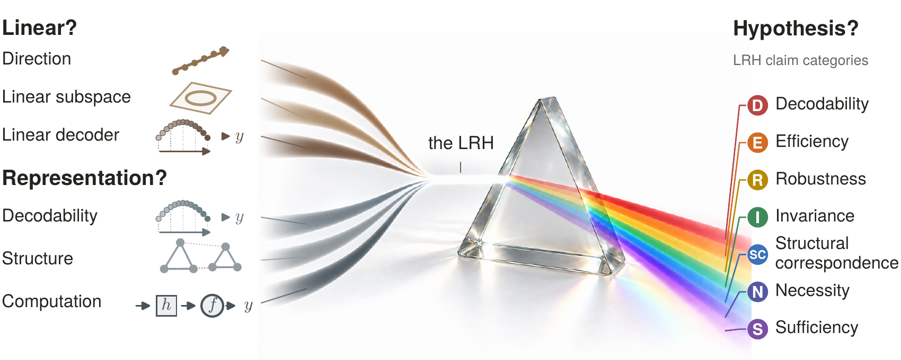

# Linear? Representation? Hypothesis?

Code, data, and literature annotations for **Linear? Representation? Hypothesis?**,
by Benjamin Heinzerling and Kentaro Inui.

The linear representation hypothesis combines different assumptions about
linearity and representation. The paper distinguishes seven kinds of claim:
decodability, efficiency, robustness, invariance, structural correspondence,
necessity, and sufficiency. Its literature review and numerical experiments
provide a framework for assessing the evidence for each claim.



## Explore the evidence

- [Literature data](data/literature/README.md): evidence ratings for 30 studies,
  rationales and primary-source references, plus the purpose-coding records.
- [Experiment map](docs/experiment-map.md): each paper figure's inputs,
  calculations, and reproduction command.
- [Numerical data](data/numerical/README.md): frozen observations, experiment
  configurations, and uncertainty definitions.

## Reproduce the results

Install [uv](https://docs.astral.sh/uv/getting-started/installation/), then run
these commands from the repository root:

```bash
uv sync --locked
uv run python scripts/verify.py
uv run python scripts/reproduce.py
```

The workflow uses CPU calculations and requires no model download. It writes
metrics and numerical plots to `out/reproduction/`. Completed outputs are
reused when their input, code, and output hashes match. See the
[reproduction guide](docs/reproduction.md) for individual analyses and tests.

The numerical plots use a simplified layout. To regenerate the manuscript's
main and appendix figures, install Cairo, fontconfig, Poppler, and the TeX Gyre fonts,
then run:

```bash
uv sync --locked --group figures
uv run --group figures python scripts/render_figures.py
```

[Figure documentation](figures/README.md) lists the system dependencies and
individual rendering commands. [Model experiments](docs/model-experiments.md)
have separate locked environments and commands for collecting activations,
fitting probes, and evaluating interventions.

## Build the paper

The manuscript sources, bibliography, and template files are in `paper/`.
With a LaTeX installation providing `pdflatex`, `bibtex`, and `texfot`, run:

```bash
./paper/compile.sh
```

The PDF and SyncTeX mapping are written to `paper/out/`. See
[paper/README.md](paper/README.md).

## Citation and licenses

[CITATION.cff](CITATION.cff) records the authors, title, and repository URL.
Code uses the [MIT license](LICENSE); original derived measurements and
annotations use [CC BY 4.0](LICENSE-DATA). [NOTICE.md](NOTICE.md) describes
third-party materials and attribution.
